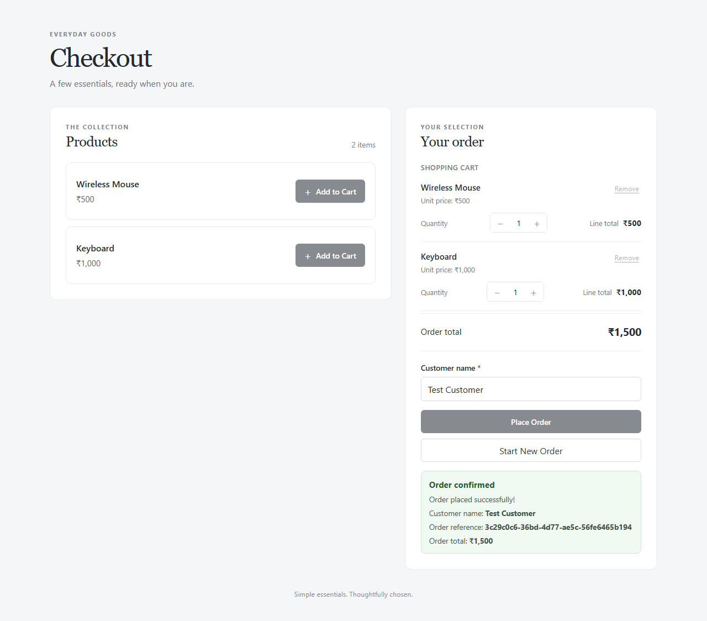
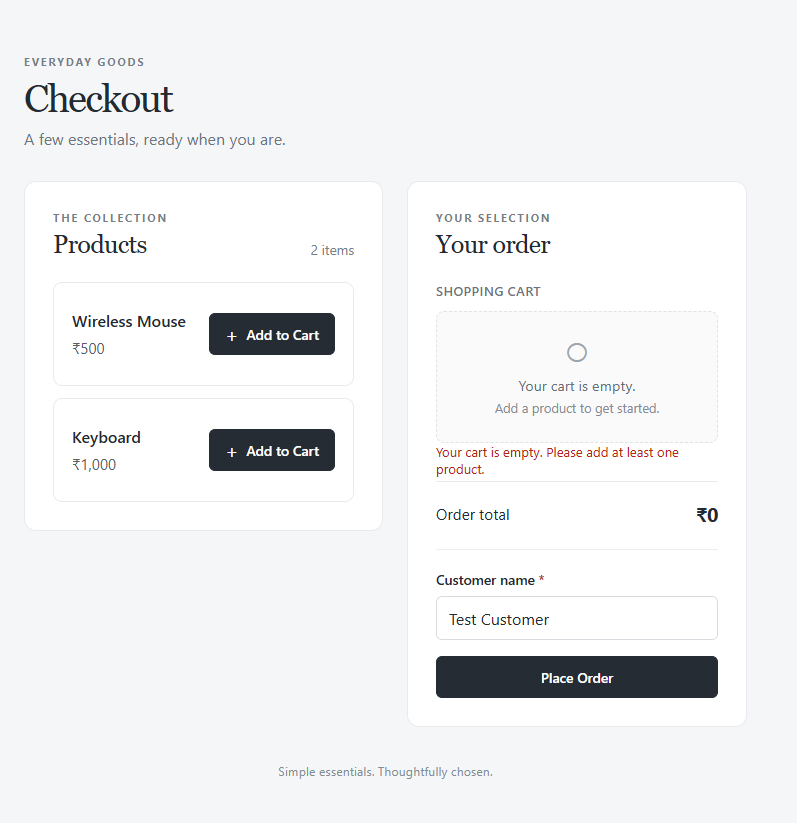
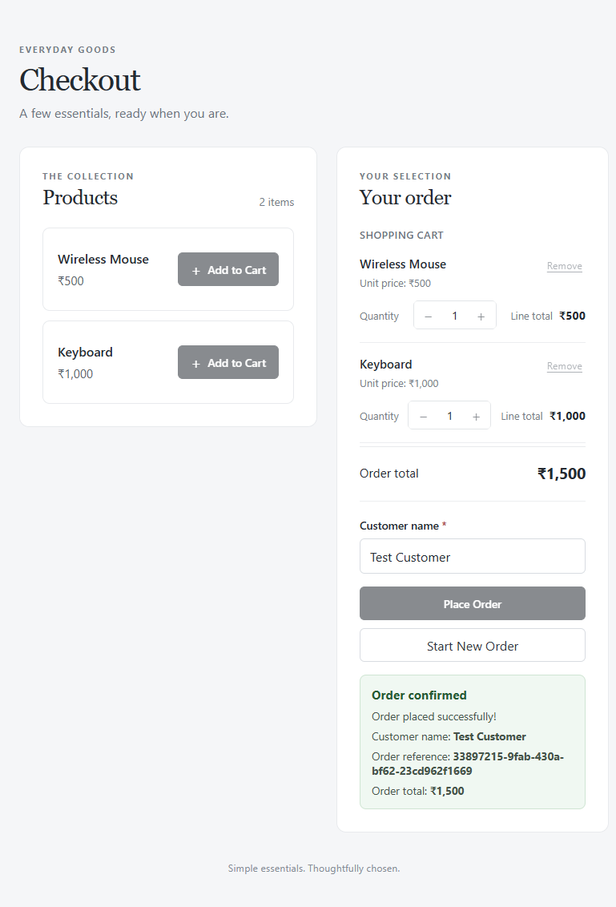

# Mini Checkout

## Problem statement

This project implements a compact checkout for two synthetic products. The hackathon focuses on trustworthy cart totals, useful validation, safe order placement, and reproducible browser testing—not payment processing or a backend.

## Project objectives

- Provide a responsive, accessible, single-page checkout.
- Keep cart and checkout rules small, explicit, and independently testable.
- Prevent invalid and duplicate order submissions.
- Verify critical customer journeys with Playwright and document manual testing with genuine evidence.

## Application features

- Wireless Mouse (₹500) and Keyboard (₹1,000).
- Add, remove, increment, and decrement cart products.
- Exact integer-paise line and order totals, formatted as INR.
- Required customer name and visible accessible validation.
- One confirmation with customer name, unique UUID reference, and submitted total.
- Synchronous duplicate-submit protection; cart and name controls freeze after order placement.
- Start New Order resets the cart, customer name, confirmation, and checkout state.
- In-memory state only; no data is persisted.

## Technology stack

| Technology | Purpose |
| --- | --- |
| HTML5 | Semantic document and accessible checkout structure |
| CSS3 | Lightweight responsive presentation |
| Vanilla JavaScript (ES modules) | Cart, checkout state, and DOM event handling without framework/runtime overhead |
| Vite 7 | Local development server and production bundling |
| Playwright Test | Isolated Chromium end-to-end testing and HTML reporting |
| npm | Reproducible dependency management via `package-lock.json` |

Vanilla JavaScript keeps a two-product, single-page application easy to inspect and avoids adding framework dependencies. Vite provides fast local startup and a production build with minimal configuration. Playwright was selected for real-browser interactions, isolated contexts, accessible locators, automatic waiting, and trace/report support.

## Application architecture

- `src/cart.js` owns the single product catalogue, in-memory cart, cart operations, line/order calculations, and INR formatting. It does not manipulate the DOM.
- `src/checkout.js` owns checkout states (`IDLE`, `SUBMITTING`, `COMPLETED`), validation, synchronous state transitions, UUID order creation, captured order data, and reset.
- `src/main.js` renders products/cart/confirmation, wires accessible UI actions to the two business modules, displays errors, and disables controls after completion.
- `index.html` holds semantic page structure and accessible validation/confirmation regions.
- `src/styles.css` provides responsive styling, keyboard focus visibility, and reduced-motion handling.

## Project directory structure

```text
.
├── evidence/                    # Genuine automated/manual screenshots
├── src/
│   ├── cart.js
│   ├── checkout.js
│   ├── main.js
│   └── styles.css
├── tests/
│   └── checkout.spec.js         # TC-001 through TC-003
├── .gitignore
├── DEFECT_REPORT.md
├── favicon.svg
├── index.html
├── package.json
├── package-lock.json
├── PLAN.md
├── playwright.config.js
├── README.md
├── REQUIREMENTS_TRACEABILITY.md
├── SUBMISSION_CHECKLIST.md
├── TEST_PLAN.md
└── TEST_RESULTS.md
```

Generated `node_modules/`, `dist/`, `test-results/`, and `playwright-report/` folders are ignored by Git. The report can be regenerated with the commands below.

## Prerequisites

- Node.js 20.19+ or 22.12+ (tested with Node.js 22.17.1; required by the installed Vite version)
- npm 10+ (tested with npm 10.9.2)
- Chromium installed through Playwright for browser tests

No backend, credentials, external service, or environment file is required.

## Installation

From the repository root:

```sh
npm ci
npx playwright install chromium
```

`npm ci` installs the exact dependency versions recorded by `package-lock.json`.

## Run the application

```sh
npm run dev
```

Open <http://127.0.0.1:4173>. Stop the development server with Ctrl+C.

## Production build

```sh
npm run build
```

The generated site is written to the ignored `dist/` directory.

## Automated browser testing

Run the headless Chromium suite:

```sh
npm run test:e2e
```

The Playwright configuration starts Vite automatically on port 4173 and runs each test in an isolated browser context. The three tests are:

- **TC-001:** successful checkout and exact confirmation details.
- **TC-002:** missing-name validation and cart preservation.
- **TC-003:** quantity changes and exact line/order totals.

Observe browser interactions in a visible Chromium window:

```sh
npm run test:e2e:headed
```

## Playwright HTML report

After running the tests, open the generated report:

```sh
npx playwright show-report
```

The report is served locally, normally at <http://localhost:9323>. The `npm run test:e2e:report` alias is also available. HTML reports, test output, screenshots, and traces are generated artifacts and ignored by Git; rerun the test command to regenerate them. Per-case screenshots are also retained under `evidence/`.

## Manual testing

TC-004 (empty-cart checkout) and TC-005 (rapid double-click checkout, repeat prevention, reset, and a subsequent order) were manually executed in the VS Code integrated browser. Follow the detailed steps and inspect actual observations in [TEST_PLAN.md](TEST_PLAN.md). Manual results and environment are recorded separately from automated results in [TEST_RESULTS.md](TEST_RESULTS.md).

## Test execution results

At final verification on 2026-11-25, the production build passed and the three automated cases passed in both headless and headed runs. Both mandatory manual cases were previously executed on 2026-11-24 and passed. Details, dates, and limitations are recorded in [TEST_RESULTS.md](TEST_RESULTS.md); test-to-requirement coverage is in [REQUIREMENTS_TRACEABILITY.md](REQUIREMENTS_TRACEABILITY.md).

## Evidence and reports

- Automated screenshots: `evidence/TC-001-successful-checkout.png`, `evidence/TC-002-required-field-validation.png`, and `evidence/TC-003-exact-total-calculation.png`.
- Manual screenshots: `evidence/TC-004-empty-cart-validation.png` and `evidence/TC-005-single-order-confirmation.png`.
- Earlier genuine Phase 5 screenshots are retained under `evidence/tc-001-success.png`, `evidence/tc-002-validation.png`, and `evidence/tc-003-quantity-total.png`; the uppercase-named screenshots are the current evidence set.
- Playwright HTML report: generated at `playwright-report/index.html` by `npm run test:e2e`.
- Environment and actual results: [TEST_RESULTS.md](TEST_RESULTS.md).
- Defect history: [DEFECT_REPORT.md](DEFECT_REPORT.md).

### Application screenshots

Successful order confirmation:



Empty-cart validation:



Single confirmation after the manual double-click:



## Known limitations

- Cart and checkout data are in memory and are lost on page reload.
- TC-005 has a screenshot of the resulting one-confirmation state, but no screen recording. The click sequence and observed disabled retry state are documented in the manual test record.
- The original screenshot/trace for the fixed APP-001 favicon 404 is no longer available; its initial observed output, fix, and retests are documented in `DEFECT_REPORT.md`.
- Optional exploratory scenarios beyond the mandatory cases were not separately executed.
- This is a demonstration checkout only; it has no backend, payment processing, authentication, or persistence.

## Submission readiness

**PARTIALLY READY.** All mandatory checkout behavior, automated tests, manual cases, build, and submission documents are complete. The original failure screenshot/trace for the fixed favicon issue was not retained before Phase 7 and cannot be supplied as original evidence. See [SUBMISSION_CHECKLIST.md](SUBMISSION_CHECKLIST.md) for the itemized status.

## Submission documents

- [PLAN.md](PLAN.md) — implementation requirements and phases
- [TEST_PLAN.md](TEST_PLAN.md) — risk-based test cases and manual observations
- [TEST_RESULTS.md](TEST_RESULTS.md) — actual automated and manual outcomes
- [DEFECT_REPORT.md](DEFECT_REPORT.md) — genuine defects and retests
- [REQUIREMENTS_TRACEABILITY.md](REQUIREMENTS_TRACEABILITY.md) — requirement coverage
- [SUBMISSION_CHECKLIST.md](SUBMISSION_CHECKLIST.md) — readiness checklist
